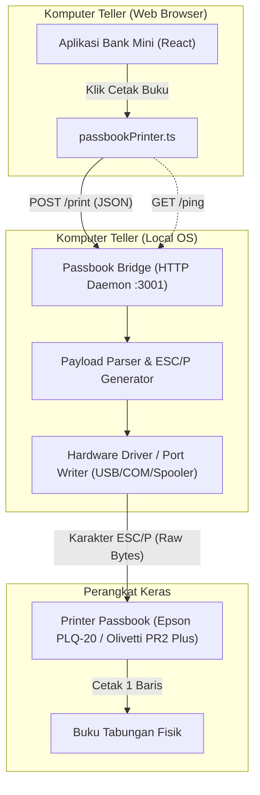

# Dokumen Kebutuhan Sistem (SRS): Passbook Bridge Lokal

## 1. Pendahuluan

### 1.1 Latar Belakang
Aplikasi Core Banking (Bank Mini) berjalan di lingkungan peramban web (browser). Untuk mencetak transaksi langsung ke buku tabungan fisik menggunakan printer dot-matrix khusus buku tabungan (*passbook printer* seperti Epson PLQ-20, Olivetti PR2 Plus), browser web memiliki keterbatasan dalam mengakses port perangkat keras secara langsung (terutama port USB, Serial COM, atau Driver Spooler raw ESC/P).

Oleh karena itu, dibutuhkan sebuah aplikasi perantara lokal (**Passbook Bridge**) yang berjalan di komputer teller sebagai *background service* / *daemon* untuk menerima data transaksi dari aplikasi web dan meneruskannya ke printer passbook.

### 1.2 Tujuan Dokumen
Dokumen ini mendefinisikan seluruh spesifikasi kebutuhan fungsional, non-fungsional, format payload API, protokol komunikasi, serta spesifikasi perintah cetak dot-matrix (ESC/P) yang harus diimplementasikan pada aplikasi Passbook Bridge lokal.

---

## 2. Arsitektur Sistem



### 2.1 Alur Kerja Komunikasi
1. Teller menyelesaikan transaksi (Setor / Tarik).
2. Browser menampilkan modal struk transaksi yang menyertakan tombol **"Cetak Buku"**.
3. Saat tombol ditekan, browser mengirim request HTTP `POST` dengan payload JSON ke `http://localhost:3001/print`.
4. Bridge lokal menerima data, memvalidasi format, dan mengonversinya menjadi byte command ESC/P standar dot-matrix.
5. Bridge mengirim byte command tersebut ke port printer passbook yang terpasang.
6. Printer mencetak satu baris transaksi pada buku tabungan.
7. Bridge mengembalikan respon HTTP `200 OK` ke browser.

---

## 3. Spesifikasi Kebutuhan Antarmuka (API Specification)

Aplikasi Bridge lokal wajib menyediakan server HTTP lokal dengan konfigurasi:
- **Host**: `127.0.0.1` / `localhost`
- **Port Default**: `3001`
- **CORS Support**: Wajib mengaktifkan CORS (Cross-Origin Resource Sharing) karena dipanggil langsung dari browser aplikasi web.

### 3.1 Konfigurasi Header CORS
Setiap endpoint wajib menyertakan header respon berikut:
```http
Access-Control-Allow-Origin: *
Access-Control-Allow-Methods: GET, POST, OPTIONS
Access-Control-Allow-Headers: Content-Type, Authorization
```
Untuk request `OPTIONS` (Preflight), bridge harus segera merespon dengan HTTP status `204 No Content` atau `200 OK`.

---

### 3.2 Endpoint: Health Check (`GET /ping`)
Digunakan oleh web app untuk memastikan bahwa aplikasi bridge aktif dan printer siap.

* **Method**: `GET`
* **Path**: `/ping`
* **Response Sukses (200 OK)**:
  ```json
  {
    "status": "online",
    "printer_connected": true,
    "printer_name": "EPSON PLQ-20",
    "version": "1.0.0"
  }
  ```

---

### 3.3 Endpoint: Cetak Transaksi (`POST /print`)
Menerima data transaksi dari web app dan mencetak ke buku tabungan.

* **Method**: `POST`
* **Path**: `/print`
* **Headers**: `Content-Type: application/json`

#### Request Body Schema (Sesuai `passbookPrinter.ts`)
```json
{
  "tanggal": "2026-10-20 13:45:00",
  "kode_transaksi": "BKM001/10/26",
  "jenis_transaksi": "setor",
  "jumlah": 100000,
  "saldo_sesudah": 250000,
  "keterangan": "BKM001/10/26",
  "petugas": "SRI Y"
}
```

#### Deskripsi Field
| Field | Tipe | Wajib | Keterangan |
|---|---|---|---|
| `tanggal` | `string` | Ya | Tanggal transaksi (format `DD/MM/YYYY`, `YYYY-MM-DD`, atau ISO string) |
| `kode_transaksi` | `string` | Ya | Kode transaksi (contoh: `BKM001/10/26`, `BKK002/10/26`) |
| `jenis_transaksi` | `string` | Ya | Tipe transaksi (`setor`, `tarik`, `bunga`, `biaya_admin`) |
| `jumlah` | `number \| string` | Ya | Nominal transaksi |
| `saldo_sesudah` | `number \| string` | Ya | Saldo akhir setelah transaksi |
| `keterangan` | `string` | Tidak | Keterangan tambahan transaksi |
| `petugas` | `string` | Tidak | Inisial/Nama teller yang memproses |

#### Respon Sukses (200 OK)
```json
{
  "success": true,
  "message": "Baris transaksi berhasil dicetak ke buku tabungan"
}
```

#### Respon Gagal (400 / 500 / 503)
* **400 Bad Request**: Payload tidak valid atau field wajib tidak lengkap.
  ```json
  {
    "success": false,
    "message": "Field 'kode_transaksi' dan 'jumlah' wajib diisi."
  }
  ```
* **503 Service Unavailable / 500 Internal Error**: Printer offline, kertas macet, atau port tidak ditemukan.
  ```json
  {
    "success": false,
    "message": "Printer offline atau tidak terhubung pada port COM3."
  }
  ```

---

## 4. Format Cetak & Spesifikasi ESC/P Dot-Matrix

### 4.1 Layout Kolom Buku Tabungan Standar
Buku tabungan bank mini umumnya memiliki lebar 65–72 karakter (Pitch 10 cpi / Condensed 17 cpi). Struktur kolom standar:

```
| TANGGAL  | KODE  |   DEBET (Rp)  |  KREDIT (Rp)  |   SALDO (Rp)  | VALIDASI |
|----------|-------|---------------|---------------|---------------|----------|
| 20/10/26 | SET   |               |    100.000,00 |    250.000,00 | SRI Y    |
| 21/10/26 | TAR   |     50.000,00 |               |    200.000,00 | SRI Y    |
```

### 4.2 Spesifikasi Lebar Kolom
| No | Nama Kolom | Lebar Karakter | Format Teks | Contoh |
|---|---|---|---|---|
| 1 | Tanggal | 9 Karakter | Rata Kiri (`DD/MM/YY`) | `20/10/26 ` |
| 2 | Sandi / Kode | 5 Karakter | Rata Kiri (`SET` / `TAR`) | `SET  ` |
| 3 | Debet (Pengurangan) | 13 Karakter | Rata Kanan (Kosong jika Setor) | `    50.000,00` |
| 4 | Kredit (Penambahan) | 13 Karakter | Rata Kanan (Kosong jika Tarik) | `   100.000,00` |
| 5 | Saldo | 15 Karakter | Rata Kanan | `   250.000,00` |
| 6 | Validasi (Petugas) | 12 Karakter | Rata Kiri | ` SRI Y      ` |

### 4.3 Perintah Byte ESC/P (Standar Epson PLQ Series)
1. **Initialize Printer**: `0x1B, 0x40` (`ESC @`) — Me-reset printer ke status awal.
2. **Aktifkan Font Condensed**: `0x0F` (`SI`) — Mengaktifkan mode huruf rapat agar seluruh kolom muat dalam 1 baris buku tabungan.
3. **Data Karakter**: Teks 1 baris string ASCII yang sudah di-padding.
4. **Line Feed & Carriage Return**: `0x0D, 0x0A` (`CR LF`) — Mencetak baris dan menggeser ke baris berikutnya.
5. **Eject Kertas (Opsional)**: `0x0C` (`FF`) atau perintah khusus passbook eject `0x1B, 0x19` jika diperlukan melepas buku setelah cetak.

---

## 5. Kebutuhan Non-Fungsional

### 5.1 Kompatibilitas Sistem Operasi & Driver
- **Sistem Operasi**: Windows 10 / Windows 11 (64-bit), Linux (Ubuntu/Debian).
- **Target Printer**:
  - Epson PLQ-20 / PLQ-30 / PLQ-50
  - Olivetti PR2 / PR2 Plus / PR4
  - Compuprint SP40 Plus
  - Wincor Nixdorf 4915+
- **Metode Koneksi Printer**:
  - **Windows Spooler RAW**: Menembak printer driver berjenis "Generic / Text Only" atau driver resmi melalui Win32 Raw Print API.
  - **Direct USB/Serial Port**: Komunikasi langsung via virtual COM port (contoh: `COM3` pada Windows, `/dev/ttyUSB0` pada Linux).

### 5.2 Kebutuhan Deployment & Pengoperasian
- **Ukuran Ringan**: Bridge berjalan di background dengan penggunaan memori < 60 MB.
- **Autostart**: Dapat didaftarkan sebagai Windows Service (via NSSM) atau diletakkan pada folder *Startup* Windows agar otomatis aktif saat komputer teller dinyalakan.
- **File Konfigurasi (`config.json`)**:
  ```json
  {
    "port": 3001,
    "printer_type": "spooler",
    "printer_name": "EPSON PLQ-20 ESC/P2",
    "serial_port": "COM3",
    "baud_rate": 9600,
    "log_level": "info"
  }
  ```

---

## 6. Penanganan Error (Error Handling)

| Skenario | Tindakan Bridge | Respon ke Web App |
|---|---|---|
| Bridge belum dinyalakan di PC teller | Koneksi ditolak oleh OS | Web App menampilkan: *"Aplikasi cetak (Bridge) tidak merespon. Pastikan aplikasi jalan di localhost:3001."* |
| Printer dalam kondisi mati / kabel tercabut | Bridge mendeteksi port terputus | HTTP 503: *"Printer tidak terdeteksi atau mati"* |
| Kertas/Buku belum dimasukkan | Printer berbunyi 'beep' / status busy | Timeout 10 detik lalu kembalikan HTTP 500: *"Buku tabungan belum dimasukkan ke printer"* |
| Port serial sedang dipakai aplikasi lain | Port access denied | HTTP 500: *"Port printer terkunci oleh proses lain"* |

---

## 7. Rencana Pengembangan Lanjutan (Future Roadmap)
1. **Fitur Baris Cetak (Line Skipping)**:
   - Menambahkan field `baris_ke` (1 s/d 40) pada request body.
   - Bridge akan mengirim perintah `ESC J n` (vertical spacing) untuk memajukan cetak tepat ke nomor baris yang diinginkan tanpa harus mencetak dari baris 1.
2. **Tray Icon / Status Indicator**:
   - Menampilkan ikon kecil di taskbar Windows untuk memudahkan teller melihat apakah printer sedang 'Ready', 'Busy', atau 'Error'.
